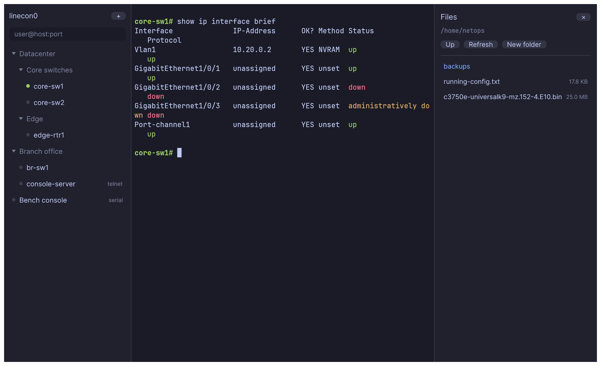

# linecon0

`line con 0`

A portable SSH, Telnet and serial client for network engineers. It uses PuTTY
as its protocol engine, so it can still talk to old hardware that needs SSH-1,
group1-sha1, 3des-cbc, arcfour, ssh-dss or SHA-1 ssh-rsa.

Each platform gets a single executable with no installer, bundled runtime or
WebView: macOS (arm64, x64), Linux (x64, arm64) and Windows (x64).

The default view is a terminal and a collapsible session sidebar. Everything else
appears when you ask for it.

Folders carry settings and children inherit them, and the inspector shows where each
value comes from:

When a device and your settings cannot agree, you see exactly what it offered against
what was allowed, and can allow legacy algorithms with one click:

A file browser opens on request, on the same connection settings:

Early development; see [docs/STATUS.md](docs/STATUS.md).

## Install

Downloads are on the [releases page](https://github.com/tonhe/linecon/releases).

- **macOS**: unzip `linecon0-macos-*.app.zip` (`arm64` for Apple silicon, `x64` for Intel) and drag `linecon0.app` to
  Applications. Releases from v0.0.1-alpha.15 are signed and notarized. `linecon-macos-*-cli.tar.gz` is the same program
  as a bare executable for terminal use, with no app icon.
- **Linux**: unpack `linecon-linux-*.tar.gz` and run `./linecon`.
- **Windows**: run `linecon-windows-x64.exe`. SmartScreen may warn, since it is unsigned. See the
  [code signing policy](docs/code-signing-policy.md). A console window may flash when starting it from Explorer.

### Code signing

Windows releases are unsigned for now, so SmartScreen warns. See the
[code signing policy](docs/code-signing-policy.md), which also covers privacy: the program has no telemetry and
connects only where you tell it to, plus GitHub if you agree to update checks.

## Use

Run `linecon` with no arguments for the window, or with arguments for a command-line
client (`linecon --help` lists them). A file named `linecon.portable` next to the binary
keeps config, known hosts and logs in a `linecon-data` folder beside it.

| Shortcut (Cmd on macOS) | |
|---|---|
| Ctrl+Shift+P | Command palette |
| Ctrl+Shift+B | Hide or show the sidebar |
| Ctrl+Shift+I | Settings for this session |
| Ctrl+Shift+S | File browser |
| Ctrl+Shift+D / E | Split right / down |
| Ctrl+Shift+W | Close pane |
| Ctrl+Shift+F | Search scrollback |
| Ctrl+Shift+C / V | Copy / paste (right-click also pastes, and selecting copies) |
| Ctrl+Shift+R | Reconnect |
| Alt+arrows | Move between panes |

Drop sessions from another tool on the window to import them: a SecureCRT XML export or Sessions folder, PuTTY or
KiTTY `.reg` files and portable sessions, or an OpenSSH config. Folders are kept. SecureCRT passwords are decrypted
into your OS secret store, asking for its configuration passphrase if you set one. Other tools' saved passwords are left
behind. A SecureCRT export can also hold your saved credentials and private keys, so treat it like a password file and
delete it afterwards.

Drop an iTerm2 `.itermcolors` or Windows Terminal `.json` scheme on the window to import it.

## Moving sessions

Export everything from the command palette, or one folder by right-clicking it, to a readable file described in
[docs/session-format.md](docs/session-format.md). Drop that file on another window to import it. Folders and
inherited settings come along, usernames and key paths only if you ask, and passwords never.

## Agent access

linecon0 can act as an [MCP](https://modelcontextprotocol.io) server so an AI agent can work in sessions you
choose. These are live sessions on real equipment, and output from a device could contain text that tries to
instruct the agent, so everything is opt-in:

- The server is off until you start it from the command palette.
- Each pane starts with no access. You grant read or control one pane at a time, and it is never saved.
- A pane with access is marked on screen, and input is refused while it is waiting on a password.
- Agents cannot open connections, read saved passwords or change settings.

Point your MCP client at the command `linecon mcp`.

## Build

    git clone --recursive https://github.com/tonhe/linecon
    cargo build --release -p linecon

Needs Rust, CMake and a C compiler. Tests use Docker for the legacy SSH server where available.

## License

MIT. See [LICENSE](LICENSE). PuTTY is MIT licensed by Simon Tatham and contributors, and JetBrains Mono and Inter are
under the SIL Open Font License. `linecon --licenses` prints every notice the program carries, including its
dependencies'. linecon0 is built from PuTTY's main branch at the commit `linecon --version` shows, not a tagged release.
