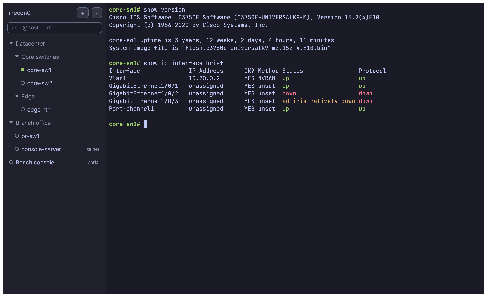
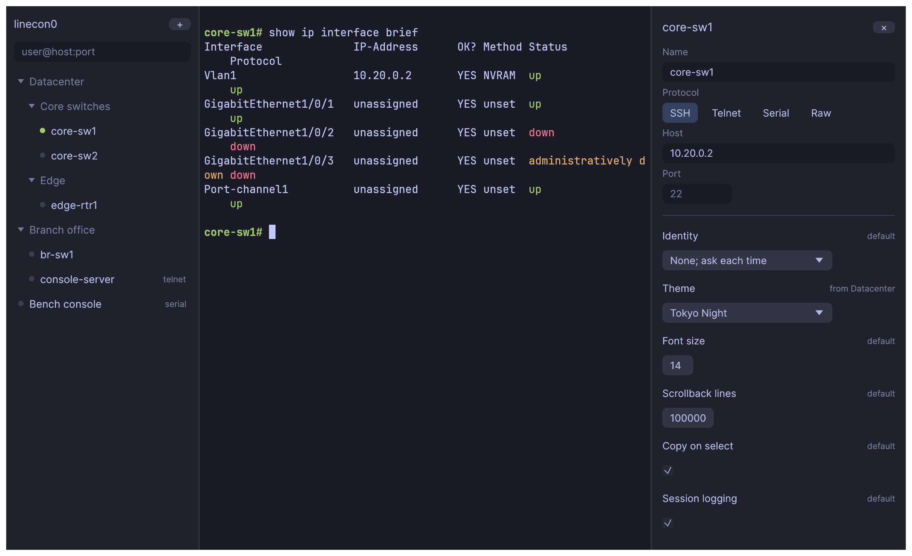
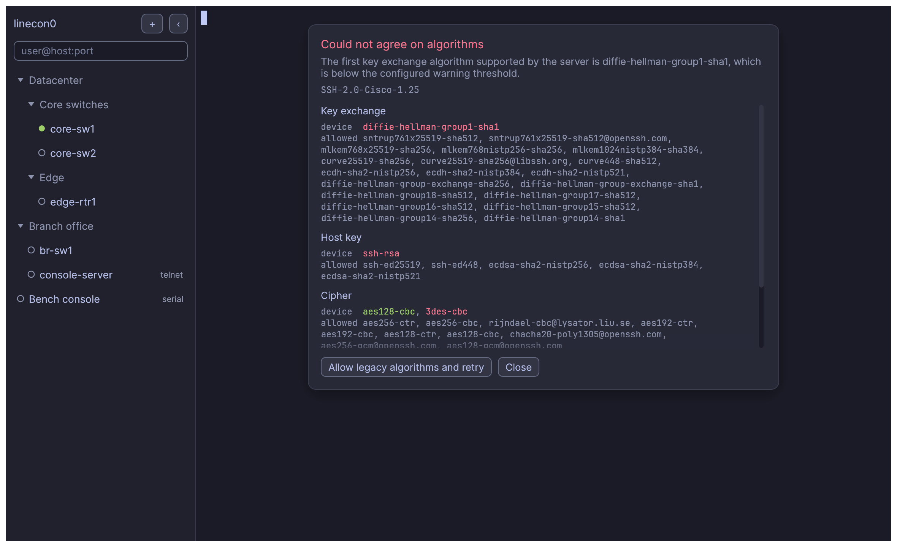

# linecon0

`line con 0`

A portable SSH, Telnet and serial client for network engineers. It uses PuTTY
as its protocol engine, so it can still talk to old hardware that needs SSH-1,
group1-sha1, 3des-cbc, arcfour, ssh-dss or SHA-1 ssh-rsa.

Each platform gets a single executable with no installer, bundled runtime or
WebView: macOS (arm64, x64), Linux (x64, arm64) and Windows (x64).

The default view is a terminal and a collapsible session sidebar. Everything else
appears when you ask for it.

Folders carry settings and children inherit them, and the inspector shows where each
value comes from:

When a device and your settings cannot agree, you see exactly what it offered against
what was allowed, and can allow legacy algorithms with one click:

Early development; see [docs/STATUS.md](docs/STATUS.md).

## Install

Downloads are on the [releases page](https://github.com/tonhe/linecon/releases).

- **macOS**: unzip `linecon0-macos-*.app.zip` (`arm64` for Apple silicon, `x64` for Intel). The app
  is not notarized yet, so macOS blocks it at first. Either run
  `xattr -dr com.apple.quarantine linecon0.app`, or try to open it once and then choose
  Open Anyway under System Settings > Privacy & Security. The `.tar.gz` is the same program as a
  bare executable for terminal use.
- **Linux**: unpack `linecon-linux-*.tar.gz` and run `./linecon`.
- **Windows**: run `linecon-windows-x64.exe`. SmartScreen may warn, since it is unsigned.

## Use

Run `linecon` with no arguments for the window, or with arguments for a command-line
client (`linecon --help` lists them). A file named `linecon.portable` next to the binary
keeps config, known hosts and logs in a `linecon-data` folder beside it.

| Shortcut (Cmd on macOS) | |
|---|---|
| Ctrl+Shift+P | Command palette |
| Ctrl+Shift+B | Toggle sidebar |
| Ctrl+Shift+D / E | Split right / down |
| Ctrl+Shift+W | Close pane |
| Ctrl+Shift+F | Search scrollback |
| Ctrl+Shift+C / V | Copy / paste |
| Ctrl+Shift+R | Reconnect |
| Alt+arrows | Move between panes |

Drop an iTerm2 `.itermcolors` or Windows Terminal `.json` scheme on the window to import it.

## Build

    git clone --recursive https://github.com/tonhe/linecon
    cargo build --release -p linecon

Needs Rust, CMake and a C compiler. Tests use Docker for the legacy SSH server where available.

## License

MIT. See [LICENSE](LICENSE). PuTTY is MIT licensed by Simon Tatham and contributors.
JetBrains Mono and Inter are under the SIL Open Font License; see `crates/linecon/assets/fonts`.
